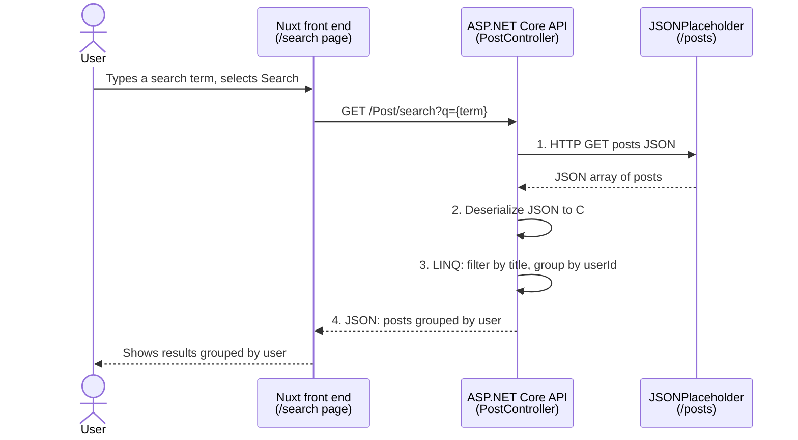

# Full-Stack Developer Take-Home Test

Thanks for taking the time to do this exercise. You'll build a small post search feature across an existing **Nuxt** front end and **ASP.NET Core** back end.

## The task

Build a search page that lets a user search posts by title and see the matching posts **grouped by user**.



### Back end (`api.fullstack`)

Finish `Controllers/PostController.cs` so that it:

1. Makes an HTTP call to download the posts JSON from <https://jsonplaceholder.typicode.com/posts>.
2. Deserializes the JSON into C# objects.
3. Uses LINQ to find the posts whose title matches the search term, and groups them by user.
4. Returns the grouped results to the front end as JSON.

Each post in the source data looks like this:

```json
{
  "userId": 1,
  "id": 1,
  "title": "sunt aut facere repellat provident occaecati excepturi optio reprehenderit",
  "body": "quia et suscipit ..."
}
```

The route and response shape are up to you. `GET /Post/search?q={term}` is a reasonable starting point.

### Front end (`web.fullstack`)

Finish the `/search` page in `app/pages/search.vue`. The search box and button are already in place. When the user enters a term and selects **Search**, the page should:

1. Call your back-end API with the search term.
2. Show the matching posts grouped by user.
3. Handle the states a real user would hit: loading, no results, and errors.

## Getting started

### Prerequisites

- [.NET 10 SDK](https://dotnet.microsoft.com/download)
- [Node.js](https://nodejs.org/) 20 or later

### Run the back end

```bash
cd api.fullstack/api.fullstack
dotnet run
```

The API listens on `http://localhost:5286`.

### Run the front end

```bash
cd web.fullstack
npm install
npm run dev
```

Open <http://localhost:3000/search>.

## How to submit

1. Fork this repository: <https://github.com/dzhu2005/full-stack-development/>
2. Do your work in your fork, committing as you go.
3. Open a pull request from your fork back to this repository.
4. In the pull request description, plase include your name.
   

We'll review your pull request before scheduling the interview, and we may ask you to walk through it.

## What we look at

- **It works.** Searching from the page returns correctly grouped results.
- **Code clarity.** Readable, well-structured code on both sides.
- **API design.** A sensible endpoint and response shape.
- **Good practice.** Sensible use of `HttpClient`, async code, and error handling.
- **User experience.** The page is clear and handles empty and failure cases.

Tests are welcome but not required. Keep the scope small; we value a clean, working solution over extra features.
